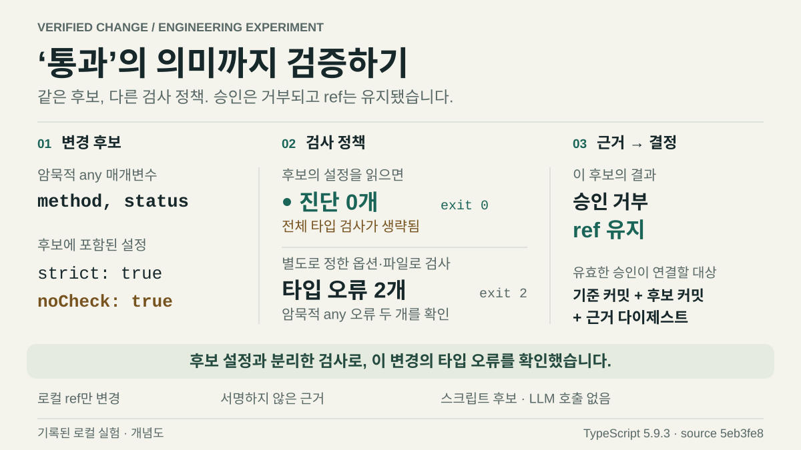

# Verified Change Lab

**검사는 통과했다. 반영할 코드는 같은가?**

[English](README.md) · [설계와 신뢰 범위](docs/design.ko.md)

검사 통과와 승인 사이에 작업 폴더가 바뀔 수 있습니다. 그 폴더를 그대로 반영하면 검사하지 않은 코드가 들어갑니다. 변경안이 검사 설정까지 바꿀 수 있다는 문제도 있습니다.

가상의 변경안을 먼저 Git 커밋으로 고정하는 개인 실험입니다. 정해 둔 정책에 따라 별도 프로세스에서 각 커밋을 검사하고, 승인에는 후보와 검증 근거를 기록합니다. 로컬 `release` 브랜치가 예상한 기준 커밋을 가리킬 때만 검사한 커밋으로 바꿉니다. 일부러 잘못 만든 비교 경로는 검사 뒤 바뀐 작업 폴더를 커밋하며, 이후 런타임 검사에서 오류가 드러납니다.

검사 설정을 바꾸는 대조군은 `strict: true`와 `noCheck: true`를 함께 사용합니다. TypeScript는 이 설정대로 타입 검사를 생략해 오류를 보고하지 않습니다. 신뢰하는 검사기는 옵션과 소스 파일 목록을 따로 정해 오류를 발견하고 승인을 거절합니다. 후보가 바꾼 검사 옵션에는 영향을 받지 않지만, 현재 정책은 소스에 적는 검사 생략 지시까지 금지하지 않습니다.

[](docs/figures/verification-policy.ko.svg)

소스 `5eb3fe8`에서 기록한 TypeScript 5.9.3 반례의 개념도입니다. 하단에 당시 버전을 명시했으며 현재 실행 결과를 표시하지 않습니다. `pnpm experiment`로 새 근거를 생성할 수 있습니다.

## 직접 실행

**Node 24.12–24.x**, Git, **pnpm 11.25.0**이 필요합니다. Windows x64의 Node 24.12.0과 24.19.0에서 검증했으며, 모든 버전·운영체제를 검사한 것은 아닙니다. 설치 이후 네트워크 호출이나 인증 정보는 필요하지 않습니다.

```sh
pnpm install --frozen-lockfile
pnpm check
pnpm experiment
pnpm serve
```

**http://127.0.0.1:4318**에서 생성된 보고서를 봅니다. 한국어 브라우저에서는 한국어가 기본이며, 영어로 전환해도 선택한 사례와 펼친 근거를 유지합니다.

## 실험으로 드러내는 차이

| 사례              | 관찰 결과                                                                                            |
| ----------------- | ---------------------------------------------------------------------------------------------------- |
| 검사 후 코드 변경 | 잘못된 경로는 미검증 코드를 반영해 런타임 검사에 실패합니다. 보호된 경로는 검사한 커밋을 유지합니다. |
| 약해진 검증 근거  | 빈 검사 결과나 후보가 완화한 컴파일 설정으로는 독립된 검증 정책을 통과할 수 없습니다.                |
| 근거 재사용       | 다른 후보의 근거와 만료된 근거를 거절합니다.                                                         |
| 동시 승인 경쟁    | 두 프로세스가 같은 기준에서 변경을 시도하며, Git의 조건부 갱신은 하나만 성공합니다.                  |
| 응답 전 종료      | Git 반영 직후 실행기를 강제 종료합니다. 재조회는 현재 ref만 확인하고 변경 주체를 단정하지 않습니다.  |

실제 Git 객체, 별도 검사 프로세스, 컴파일러와 로컬 ref 변경을 사용합니다. 보고서의 **승인은 스크립트가 수행**하며, 만료 실험은 실제 5분을 기다리는 대신 평가 시각을 주입합니다. 사례별 관측과 명령 실행 기록을 남깁니다.

살펴볼 설계 판단은 세 가지입니다.

- **코드와 검사 정책을 함께 연결합니다.** 근거는 불변 커밋·트리와 독립적으로 정한 검사에 속합니다. 검사 이름과 존재 여부만으로 실제 검사 내용을 알 수는 없습니다.
- **현재 상태가 맞을 때만 반영합니다.** 선택한 후보와 예상 기준 커밋을 Git의 조건부 갱신에 전달합니다. 경쟁하는 승인이 다른 후보를 조용히 덮어쓰지 못합니다.
- **관측과 변경 주체를 구분합니다.** 응답이 사라진 뒤 ref를 읽으면 현재 값은 알 수 있습니다. 누가 바꿨는지, 앞선 변경이 나중에 되돌려졌는지까지 알 수는 없습니다.

[설계 문서](docs/design.ko.md)에서 필수 검사 범위, 프로세스 정리, A-B-A 반례와 소스 지문의 한계를 설명하고 관련 구현을 안내합니다.

검사할 커밋의 사본을 보관할 공간이 필요하고, 후보나 정책이 바뀌면 다시 검토해야 합니다. 이 실험은 로컬 Git ref만 변경하며, 배포에는 별도의 통제가 필요합니다.

## 사람이 직접 승인하기

```sh
pnpm lab prepare
```

출력된 diff, 정확한 커밋, 필수 검사와 근거 digest를 검토하세요. 이후 실행할 `approve`, `apply`, `reconcile` 명령을 그대로 출력합니다. 승인은 로컬 결정만 기록하고, 반영은 생성된 예제 저장소의 `refs/heads/release`만 변경합니다. 근거는 검증 시작 5분 후 만료됩니다. [수동 승인 흐름과 확인 규칙](docs/design.ko.md#manual-approval).

## 공개 범위

독립적으로 만든 가상 코드이며 회사 구현, 운영 성과나 LLM 호출을 포함하지 않습니다. 자동화 도구에 필요한 변경 통제의 경계를 다루는 실험이며 모델의 성능을 평가하지 않습니다.

Git 변경은 무시 목록에 있는 `.lab/` 아래 새로 생성한 예제 저장소에만 적용합니다. Git 자식 프로세스는 상속된 `GIT_*` 변수를 제거해, 실행 환경의 객체 경로나 설정이 예제 명령의 대상을 바꾸지 않도록 합니다. 사용자 저장소를 받거나 원격 브랜치를 공개하거나 배포하는 명령은 없습니다. 원시 근거는 `.lab/`, 로컬 경로를 정리한 보고서는 `dist/report.json`에 남깁니다. 소스 지문, 실행 환경과 Git 작업 폴더의 변경 여부를 함께 기록합니다.

로컬 소스와 프로세스를 신뢰하는 실행기이며 **샌드박스나 사용자 인증을 갖춘 승인 시스템은 아닙니다.** 로컬 파일 작성자는 서명되지 않은 기록을 위조할 수 있습니다. **조건부 ref 갱신은 일회용 실행 권한이 아닙니다.** A-B-A 테스트가 그 한계를 드러냅니다. 다섯 사례의 보고서는 선언한 예제 계약을 확인하며 일반적인 정확성을 보장하지 않습니다. [전체 한계와 설계 절충](docs/design.ko.md#boundaries-and-tradeoffs).

MIT 라이선스입니다. [Git 조건부 갱신](https://git-scm.com/docs/git-update-ref), [Node 프로세스](https://nodejs.org/api/child_process.html), [TypeScript 검사](https://www.typescriptlang.org/tsconfig/noCheck.html)를 바탕으로 만들었습니다.
