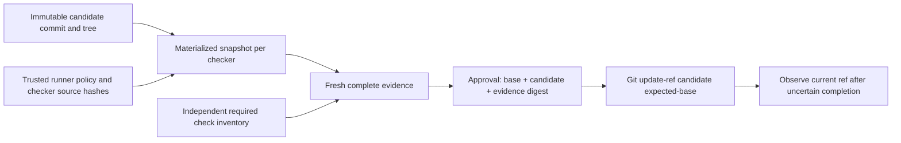

# Verified Change Lab

**A check passed. Did we apply the bytes it checked?**

[한국어 설명](README.ko.md)

This small experiment reproduces a plausible automation mistake: verify a proposed change, wait for approval, then commit the current workspace. An edit during that gap makes the green result refer to different code. The naive path actually selects the unchecked commit in an isolated synthetic Git repository; a subsequent runtime check fails. The protected path selects the exact verified commit despite the same workspace drift.

It uses real Git objects, separate Node checker processes, the TypeScript compiler, competing executor processes and an actual post-CAS process termination. It does not invoke an LLM or a remote service. The retry-policy source is an original fixture, not a production retry library or employer implementation.

## Run the experiment

Requires **Node 24.12–24.x**, Git and pnpm 11. No runtime dependencies, credentials or network calls after installation.

```sh
pnpm install --frozen-lockfile
pnpm check
pnpm experiment
pnpm serve
```

Open **http://127.0.0.1:4318**. The read-only report defaults to Korean for a Korean browser and supports English; changing language retains the selected case and open evidence panels. The report is generated by the experiment, not canned success data. Each run keeps raw commands and checker outputs in `.lab/` and writes a sanitized `dist/report.json` with a source fingerprint, runtime versions and honest Git dirty-state provenance.

All Git mutations target generated fixtures inside this project's ignored `.lab/`; the sanitized report is written to `dist/`. No command accepts a user repository. There are no remotes, deployment operations or worktree checkouts. Fixture repositories use an empty Git template and isolated global/system configuration.

## Five counterexamples, observable outcomes

| Case                 | Deliberate failure                                                          | Observation                                                                                                                               |
| -------------------- | --------------------------------------------------------------------------- | ----------------------------------------------------------------------------------------------------------------------------------------- |
| Workspace drift      | Commit mutable workspace after verifying another commit                     | Naive path selects unchecked bytes; post-hoc runtime check fails. Protected path selects the checked commit.                              |
| Evidence semantics   | Empty success; candidate configuration enables `noCheck` alongside `strict` | Naive compiler reports green; independent trusted options detect errors. Missing or weakened evidence cannot approve a change.            |
| Evidence reuse       | Use A's evidence to approve B                                               | Candidate binding refuses it. A separately injected logical expiry boundary also refuses stale evidence.                                  |
| Competing approvals  | Two processes race from the same base                                       | Exactly one conditional ref update succeeds; reconciliation observes one selected candidate and one conflict.                             |
| Lost acknowledgement | Terminate executor after CAS, before acknowledgement                        | Caller has no acknowledgement; reading the ref observes the candidate. A replay with the old base is refused while the ref remains there. |

The report uses **scripted approvals**, explicitly labeled in its transcript. The expiry case injects evaluation time; it does not claim to have waited five minutes. The other process and Git effects are real local I/O.

## Try a manual approval

```sh
pnpm lab prepare
```

Read the diff, exact commit, required checks, evidence digest and raw `review.json`. The command prints an exact confirmation command and a separate apply command:

```text
pnpm lab approve <generated-fixture-id> <candidate-commit> <evidence-digest>
pnpm lab apply <generated-fixture-id>
pnpm lab reconcile <generated-fixture-id>
```

An incorrect confirmation refuses approval. Evidence expires five minutes after verification starts; prepare a new fixture if it expires. `approve` only records a local decision. `apply` only updates `refs/heads/release` in that fixture's bare repository. The reviewer label is **not identity verification**.

## What is bound to what?



The approval layer imports its required checker/check inventory from `src/policy.ts`; it never infers coverage from whatever a checker happens to return. A result must have the expected IDs, a fresh invocation nonce, the exact candidate/tree/policy, bounded timestamps, successful concrete checks and a successful process outcome. Empty, partial and duplicate results are insufficient.

Strict compiler options and the source-file list belong to the trusted checker, not the candidate's `tsconfig.json`. An independent review reproduced a bypass by changing candidate configuration to `strict: false`; the regression test now shows that even a weakened config and empty file list cannot waive the required strict check. The report takes this further: the same implicit-any source passes a real naive compiler with candidate-controlled `strict: true, noCheck: true`, but fails the trusted checker. A check's name and presence do not establish what it actually checked. Unknown CLI arguments are rejected before any mutation, including the easily misread `apply … --dry-run`.

The policy digest includes the checker, runner, subprocess handling, approval/execution code, CLI, package manifest, lockfile, declared inventory and Node/TypeScript versions. Candidate Git identity and workflow policy identity are separate. Dependencies are pinned; installed dependency bytes and the Node binary are not independently attested.

Each fixed checker gets its own snapshot materialized from the candidate commit. Source hashes are checked before and after it runs. Subprocesses have a five-second deadline and a 32 KB combined output cap. On termination the runner uses its owned process group on POSIX or `taskkill /T /F` for the child PID on Windows. A real descendant-heartbeat test checks cleanup. These bounds contain accidental hangs; they are not hostile-code isolation.

The transcript distinguishes `directChildExitConfirmed` from `ownedTreeTerminationAcknowledged`. An ordinary successful exit leaves the latter `null`: it does not certify absence of descendants. An acknowledged platform tree-kill request is also not proof against a process that escaped its group. The fixed trusted checker does not spawn nested commands; a general worker would need OS containment, such as a job object or sandbox.

## The limit is part of the result

**A ref-value guard is not a one-time execution protocol.** The negative test intentionally moves base → candidate → base, then reuses the same still-fresh approval. CAS succeeds again. This A-B-A counterexample prevents interpreting the replay example as a consumed approval token or an exactly-once guarantee. A service needing that property would require durable operation identity and history beyond a pointer comparison.

Likewise, after a lost acknowledgement, observing the candidate establishes present state. Another writer could have selected it. Observing the base does not prove nothing happened earlier. Reconciliation therefore reports `OBSERVED_CANDIDATE`, `OBSERVED_BASE` or `OBSERVED_OTHER`; it does not invent actor attribution or overwrite a conflict.

Additional scope limits:

- Trusted local source, checker and process. Hashes/JSON are not signatures; a local writer can forge evidence, approvals or logs. Pre/post source hashing does not detect a malicious edit-and-restore during execution.
- Synthetic fixed commands only. Candidate code executes with the user's process privileges, not in a sandbox. Do not adapt this runner to untrusted submissions without isolation.
- A successful CAS changes one local Git ref. It does not deploy, change the workspace, publish a branch or perform an external side effect. The drifted workspace intentionally remains drifted.
- Freshness uses the local wall clock. Clock rollback, cross-host trust, durable fsync/crash guarantees, ref deletion and malicious symbolic-ref rewriting are outside the experiment.
- Five small runtime assertions and a strict compiler check establish this fixture's declared contract, not general correctness. No production adoption, scale or model-quality claims are made.

The tradeoff is deliberate: preserve artifact identity across an approval delay by preparing immutable candidates, rather than re-reading a convenient mutable workspace. That requires extra object/snapshot storage and a fresh review when either candidate or policy changes. It does not solve every execution problem, but it makes this particular failure visible and reproducible.

## Read the implementation

- `src/git.ts`: fixed synthetic repository and immutable candidate objects.
- `src/checker.ts`: independently running runtime and TypeScript checks.
- `src/policy.ts`, `src/protocol.ts`: required coverage, evidence validation, approval and CAS.
- `src/process.ts`, `src/execution.ts`: bounded processes, concurrency barrier and actual fault injection.
- `src/experiment.ts`: naive comparison and measured counterexamples.
- `test/protocol.test.ts`: positive control, missing evidence, binding changes, real process faults and the A-B-A negative proof.

The report keeps exact hashes and captured raw outcomes so a reviewer can trace the narrative back to execution. It records the Git revision only alongside dirty state; a fingerprint over the listed source files identifies the actual bytes. Generation refuses to stamp a run if that fingerprint changes between the beginning and end of execution.

## Primary references

The conditional update follows [Git's `update-ref` old-value check](https://git-scm.com/docs/git-update-ref). Candidate objects use [`commit-tree`](https://git-scm.com/docs/git-commit-tree). Process behavior follows [Node's child-process API](https://nodejs.org/api/child_process.html). TypeScript documents both [strict-family overrides](https://www.typescriptlang.org/tsconfig/strict.html) and [`noCheck`](https://www.typescriptlang.org/tsconfig/noCheck.html). This lab applies established mechanisms to a narrow counterexample; it does not claim a new approval or consensus protocol.

MIT licensed. Original synthetic experiment.
