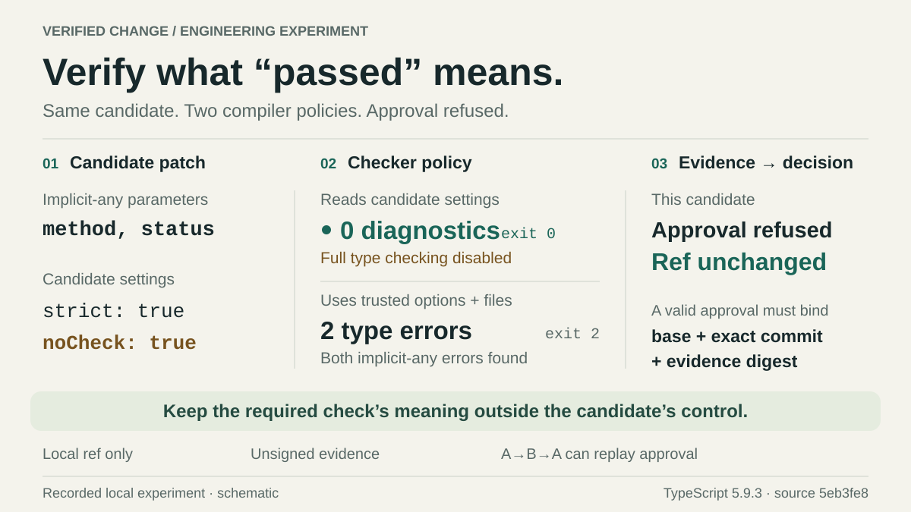

# Verified Change Lab

**A check passed. Did we select the code it checked?**

[한국어](README.ko.md) · [Design and trust boundaries](docs/design.md)

Code can change between a successful check and approval. Applying the current workspace then selects code that was never checked. A patch can also weaken the settings used to check it.

This personal lab stores fictional changes as Git commits before checking them. Separate processes check each commit under a fixed policy, and approval records the candidate and its evidence. The local `release` branch moves to that commit only if it still points to the expected base. The deliberately naive comparison commits a changed workspace instead; its subsequent runtime check fails.

A second control sets `strict: true` together with `noCheck: true`: TypeScript skips type checking as configured and reports no type errors. The trusted checker supplies its own options and source-file list, detects the errors and refuses approval. This checker ignores the candidate's compiler options, but the policy still allows source-level suppression directives.

[](docs/figures/verification-policy.en.svg)

Schematic of the recorded TypeScript 5.9.3 counterexample at source `5eb3fe8`. The footer identifies that historical run; the figure is not a live result. Run `pnpm experiment` to generate fresh evidence.

## Run locally

Requires **Node 24.12–24.x**, Git and **pnpm 11.25.0**. Verified on Windows x64 with Node 24.12.0 and 24.19.0; other releases and platforms are not exhaustively tested. No credentials or network calls after installation.

```sh
pnpm install --frozen-lockfile
pnpm check
pnpm experiment
pnpm serve
```

Open **http://127.0.0.1:4318** for the generated report. It defaults to Korean for a Korean browser, supports English and preserves the selected case and open evidence panels when switching languages.

## What the experiment makes visible

| Case                 | Observed result                                                                                                                   |
| -------------------- | --------------------------------------------------------------------------------------------------------------------------------- |
| Workspace drift      | The naive path selects unchecked code; its runtime check fails. The protected path selects the verified commit.                   |
| Weakened evidence    | Empty checks and candidate-controlled compiler settings cannot satisfy the independent verification policy.                       |
| Evidence reuse       | Another candidate's evidence and expired evidence are refused.                                                                    |
| Competing approvals  | Two processes race from one base; exactly one conditional Git ref update succeeds.                                                |
| Lost acknowledgement | The executor is terminated after Git accepts the update. Reconciliation observes the current ref without claiming who changed it. |

These are real Git objects, separate checker processes, compiler runs and local ref updates. The report uses **scripted approvals**; the expiry case injects evaluation time rather than waiting five minutes. Each case retains its observations and command transcript.

Three decisions are worth reviewing:

- **Bind the artifact and the policy.** Evidence belongs to an immutable commit/tree and independently defined checks. A check's name and presence do not establish what it checked.
- **Make approval conditional on current state.** The selected candidate and expected base are passed to Git's conditional ref update. A competing approval cannot silently overwrite a different candidate.
- **Keep observation separate from attribution.** After an acknowledgement disappears, reading the ref establishes its current value. It does not establish which executor changed it or whether an earlier change was later undone.

The [design notes](docs/design.md) explain evidence coverage, process cleanup, the A-B-A counterexample and the limits of source fingerprints. They also map each decision to its implementation.

Checking a fixed commit requires storage for its snapshots and a fresh review when the candidate or policy changes. This experiment updates a local Git ref; deployment would need its own controls.

## Try an explicit manual approval

```sh
pnpm lab prepare
```

Review the printed diff, exact commit, required checks and evidence digest. The command prints exact `approve`, `apply` and `reconcile` commands. Approval records a local decision; applying it changes only `refs/heads/release` in that generated fixture. Evidence expires five minutes after verification starts. [Manual flow and validation rules](docs/design.md#manual-approval).

## Scope

Original synthetic source; no employer implementation, production results or LLM calls. This demonstrates a change-control boundary useful to automated tooling, not a model's capabilities.

All Git mutations stay in generated repositories under the ignored `.lab/` directory. Git subprocesses discard inherited `GIT_*` variables so ambient object paths and configuration cannot redirect these fixture commands. No command accepts a user repository, publishes a branch or deploys code. Raw evidence stays in `.lab/`; a report with local paths sanitized is written to `dist/report.json`, with source fingerprints, runtime versions and Git dirty-state provenance.

The runner trusts its local source and processes. It is **not a sandbox or authenticated approval system**; local writers can forge unsigned records. A successful conditional ref update is **not a one-time execution guarantee**: the A-B-A test demonstrates the limit. The five-case report verifies its declared fixture contract, not general correctness. [Full boundaries and tradeoffs](docs/design.md#boundaries-and-tradeoffs).

MIT licensed. Built with established [Git conditional updates](https://git-scm.com/docs/git-update-ref), [Node processes](https://nodejs.org/api/child_process.html) and [TypeScript checks](https://www.typescriptlang.org/tsconfig/noCheck.html).
