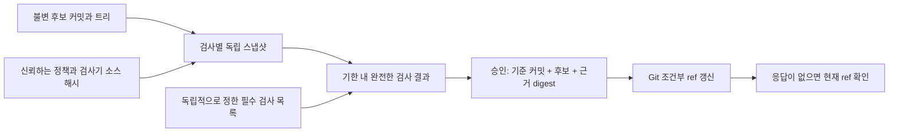

# 변경과 검증 근거를 끝까지 연결하기

[English](design.md) · [실행하기](../README.ko.md)

## 승인을 기다리는 동안 유지해야 할 두 가지

검사 통과는 특정 코드와 특정 검사 정책에 대한 결과입니다. 코드는 불변 Git 커밋과 트리로 식별합니다. 정책은 어떤 검사를 반드시 수행하고 무엇을 확인할지 정합니다. 승인을 기다리는 동안 둘 중 하나가 조용히 바뀌어서는 안 됩니다.



코드 변경 사례의 잘못된 경로는 후보를 검사한 뒤 수정된 작업 폴더를 커밋합니다. 로컬 release ref가 미검증 코드를 선택하고, 이후 런타임 검사는 실패합니다. 보호된 경로는 이미 검사한 커밋을 선택합니다. 수정된 작업 폴더는 그대로 남습니다. ref 선택은 체크아웃이나 배포가 아닙니다.

## 검사 성공의 기준은 누가 정하는가?

승인 계층은 `src/policy.ts`에서 필수 검사 목록을 읽습니다. 검사기가 반환한 목록으로 필요한 범위를 정하지 않습니다. 검사 ID, 호출별 nonce, 정확한 커밋·트리·정책, 시간 범위, 구체적인 검사 성공과 프로세스 종료 상태를 모두 확인합니다. 빈 결과, 일부 누락, 중복으로는 변경을 승인할 수 없습니다.

결과가 모두 있다는 것만으로도 충분하지 않습니다. 보고서는 후보가 정한 `strict: true, noCheck: true`로 실제 TypeScript 컴파일러를 실행합니다. implicit-any 소스에서도 오류가 없다고 보고합니다. 신뢰하는 검사기는 strict 옵션과 정확한 소스 목록을 독립적으로 정해 오류를 발견하고 승인을 거절합니다. 후보의 `strict: false`와 빈 파일 목록도 회귀 테스트로 확인합니다. 후보가 `tsconfig.json`을 바꿔 자신의 필수 검사를 생략할 수 없게 합니다.

정책 digest에는 검사기·실행기·하위 프로세스 처리·승인 및 반영 로직·CLI의 소스, 패키지와 lockfile, 필수 검사 목록, Node/TypeScript 버전이 들어갑니다. 후보 코드와 검사 정책은 별도 대상입니다. 의존성 버전은 고정하지만 설치된 의존성 파일 전체나 Node 바이너리까지 독립적으로 검증한 것은 아닙니다.

## 불변 입력과 프로세스 실행 한도

각 고정 검사기는 후보 커밋에서 만든 독립 스냅샷을 받습니다. 실행 전후에 소스 해시를 확인합니다. 검사 프로세스는 5초 제한과 합계 32 KB 출력 제한을 적용합니다.

종료가 필요하면 POSIX에서는 자신이 만든 프로세스 그룹을, Windows에서는 자식 PID를 대상으로 `taskkill /T /F`를 사용합니다. 실제 하위 프로세스의 heartbeat가 멈추는지 확인해 타임아웃 정리를 검증합니다. 우발적인 멈춤을 제한하는 장치이며 악성 코드를 격리하지는 않습니다.

실행 기록은 `directChildExitConfirmed`와 `ownedTreeTerminationAcknowledged`를 구분합니다. 정상 종료에서 후자는 `null`이며, 모든 하위 프로세스가 사라졌다는 뜻이 아닙니다. 트리 종료 요청이 수락돼도 그룹을 벗어난 프로세스까지 없다고 확인할 수는 없습니다. 고정 검사기는 하위 명령을 만들지 않습니다. 범용 실행기로 확장하려면 job object나 샌드박스 같은 운영체제 격리가 필요합니다.

예제 저장소는 비어 있는 Git 템플릿과 격리된 전역·시스템 설정으로 만듭니다. Git 변경은 이 프로젝트의 무시 목록에 있는 `.lab/` 아래 생성한 저장소에만 적용합니다. 명령은 사용자 저장소를 받거나 원격 저장소를 설정하거나 작업 폴더를 체크아웃하지 않습니다. `apply … --dry-run` 같은 미지원 인자도 실제 변경 전에 거절합니다.

<a id="manual-approval"></a>

## 사람이 직접 승인하는 흐름

`pnpm lab prepare`를 실행한 뒤 diff, 정확한 후보 커밋, 필수 검사, 근거 digest와 원본 `review.json`을 확인합니다. 준비 명령은 다음 형식의 정확한 실행 명령을 출력합니다.

```text
pnpm lab approve <생성된-fixture-id> <후보-커밋> <근거-digest>
pnpm lab apply <생성된-fixture-id>
pnpm lab reconcile <생성된-fixture-id>
```

확인 값이 다르면 승인을 거절합니다. 근거는 검증 시작 5분 후 만료되므로 오래 지났다면 새 예제를 준비합니다. `approve`는 로컬 결정만 기록합니다. `apply`는 해당 bare 저장소의 `refs/heads/release`만 갱신합니다. 표시된 검토자 이름은 사용자 인증이 아닙니다.

다섯 사례의 보고서는 스크립트가 승인하며 실행 기록에도 표시합니다. 만료 사례는 평가 시각을 주입하고 실제 5분을 기다렸다고 주장하지 않습니다. 프로세스 경쟁, 컴파일러 실행과 Git 변경은 실제 로컬 I/O입니다.

## 조건부 갱신은 일회용 실행 권한이 아니다

실행기는 후보와 예상 기준 커밋을 Git `update-ref`의 이전 값 검사에 전달합니다. 두 실행기가 같은 기준에서 경쟁해도 ref가 변경된 상태로 유지되는 동안에는 하나만 그 전환에 성공합니다.

A-B-A 반례는 기준 → 후보 → 기준으로 ref를 되돌린 뒤, 아직 만료되지 않은 승인을 재사용합니다. CAS는 다시 성공합니다. 현재 값 비교에는 앞서 변경이 일어났다는 기억이 없습니다. 따라서 재요청 거절 사례를 승인 토큰 소모나 정확히 한 번 실행 보장으로 해석할 수 없습니다. 그 성질에는 포인터 비교 외에 영속적인 작업 식별자와 이력이 필요합니다.

응답 유실 뒤 후보가 관찰돼도 다른 작성자가 변경했을 수 있습니다. 기준 ref가 관찰돼도 과거에 아무 일도 없었다는 뜻은 아닙니다. 재조회는 `OBSERVED_CANDIDATE`, `OBSERVED_BASE`, `OBSERVED_OTHER`로 현재 상태만 기록하며, 변경 주체를 추정하거나 충돌한 값을 덮어쓰지 않습니다.

## 보고서에 남기는 근거

실행마다 원시 명령과 검사 결과를 `.lab/`에 보관하고, 로컬 경로를 정리한 `dist/report.json`을 만듭니다. 보고서에는 소스 지문, 실행 환경, 정확한 해시와 수집한 결과가 들어갑니다. Git 커밋은 작업 폴더의 변경 여부와 함께 표시합니다. 소스 지문은 명시된 파일을 대상으로 하며, 실행 시작과 끝 사이에 달라지면 보고서 생성을 중단합니다.

이는 소스 관측 기록이며 서명이나 실행 증명이 아닙니다. 실행 중 파일을 바꿨다가 원복하는 공격은 전후 해시로 탐지하지 못합니다. 신뢰하는 로컬 파일 작성자는 근거·승인·기록을 위조할 수 있습니다. 보고서는 선언한 시나리오의 결과이며, `pnpm experiment`가 전체 테스트 모음까지 실행했다고 주장하지 않습니다.

<a id="boundaries-and-tradeoffs"></a>

## 한계와 설계 절충

- 로컬 소스, 검사기와 프로세스를 신뢰합니다. 후보 코드는 사용자 프로세스 권한으로 실행합니다. 격리 없이 외부의 신뢰할 수 없는 코드를 실행하는 도구로 확장하면 안 됩니다.
- 성공한 CAS는 로컬 Git ref 하나만 변경합니다. 배포, 작업 폴더 변경, 브랜치 공개나 외부 업무 실행을 수행하지 않습니다.
- 만료는 로컬 시계를 사용합니다. 시계 역행, 여러 호스트의 신뢰, 디스크 fsync 수준 내구성, ref 삭제와 악의적인 symbolic-ref 변경은 실험 범위 밖입니다.
- 작은 런타임 검사 다섯 개와 strict 컴파일 검사는 선언한 예제 계약을 확인합니다. 일반적인 정확성, 운영 적용, 처리 규모, 회사 성과나 모델 품질을 주장하지 않습니다. LLM이나 외부 서비스도 호출하지 않습니다.

승인 대기 동안 코드의 동일성을 유지하려면 추가 Git 객체와 스냅샷을 보관하고, 코드나 정책이 바뀌면 다시 검토해야 합니다. 모든 실행 문제를 해결하지는 않지만 이 실패의 경계를 재현할 수 있습니다. 코드는 독립 제작한 가상 예제이며 실무용 재시도 라이브러리나 회사 구현이 아닙니다.

## 구현 읽기

- [`src/git.ts`](../src/git.ts): 가상 저장소와 불변 후보 객체.
- [`src/checker.ts`](../src/checker.ts): 별도 프로세스의 런타임·TypeScript 검사.
- [`src/policy.ts`](../src/policy.ts), [`src/protocol.ts`](../src/protocol.ts): 필수 검사 범위, 근거 검증, 승인과 CAS.
- [`src/process.ts`](../src/process.ts), [`src/execution.ts`](../src/execution.ts): 프로세스 실행 한도, 동시 실행 준비 신호와 장애 주입.
- [`src/experiment.ts`](../src/experiment.ts): 잘못된 경로와 비교하고 반례를 기록.
- [`test/protocol.test.ts`](../test/protocol.test.ts): 정상 대조군, 검사 누락, 근거 연결 변경, 프로세스 장애와 A-B-A 한계.

## 공식 참고 문서

조건부 갱신은 [Git의 이전 값 검사](https://git-scm.com/docs/git-update-ref), 후보 객체는 [`commit-tree`](https://git-scm.com/docs/git-commit-tree)를 사용합니다. 프로세스 처리는 [Node의 child-process API](https://nodejs.org/api/child_process.html)를 따릅니다. TypeScript 문서는 [strict 하위 옵션](https://www.typescriptlang.org/tsconfig/strict.html)과 [`noCheck`](https://www.typescriptlang.org/tsconfig/noCheck.html)를 설명합니다. 알려진 기법을 좁은 반례에 적용한 실험이며 새로운 승인·합의 프로토콜을 제안하지 않습니다.
