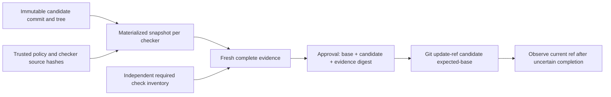

# Keeping evidence attached to a change

[한국어](design.ko.md) · [Run the lab](../README.md)

## Two identities must survive approval

A successful check belongs to both an artifact and a verification policy. The artifact is an immutable Git commit and tree. The policy defines which checks are required and what those checks mean. An approval delay must not silently replace either.



The naive drift case verifies a candidate, then commits the current workspace after an edit. Its local release ref selects unchecked code; a subsequent runtime check fails. The protected path selects the already-verified commit. The drifted workspace intentionally remains drifted: selecting a ref is not a checkout or deployment.

## Who defines a successful check?

The approval layer imports the required checker/check inventory from `src/policy.ts`. It never infers required coverage from whatever a checker returns. A result must have the expected IDs, a fresh invocation nonce, the exact candidate/tree/policy, bounded timestamps, successful concrete checks and a successful process outcome. Empty, partial and duplicate results cannot authorize a change.

Completeness is not enough. The report runs an actual TypeScript compiler with candidate-controlled `strict: true, noCheck: true`: it reports no errors for implicit-any source. The trusted checker supplies strict options and the exact source-file list independently, detects the errors and refuses approval. A regression also covers candidate `strict: false` and an empty file list. A candidate cannot waive its own required verification by changing `tsconfig.json`.

Fixed options do not imply unsuppressed semantic checking. TypeScript still honors a source-level `// @ts-nocheck` directive. A separate regression adds it to a runtime-correct candidate with implicit-any parameters: the fixed checker returns zero diagnostics, valid evidence is approved, and the conditional update succeeds. This is an allowed outcome under the declared policy, outside the five-case report. A policy that forbids source suppressions needs an explicit additional rule and review boundary; compiler success alone does not establish that rule or general type safety.

The policy digest includes checker, runner, subprocess, approval/execution and CLI sources; package manifest and lockfile; declared check inventory; and Node/TypeScript versions. Candidate identity and policy identity remain separate. Dependencies are pinned, but installed dependency bytes and the Node binary are not independently attested.

## Immutable inputs, bounded processes

Each fixed checker receives its own snapshot materialized from the candidate commit. Its source hashes are checked before and after execution. Checker processes have a five-second deadline and a 32 KB combined output cap.

On termination, the runner targets its owned process group on POSIX or the child PID with `taskkill /T /F` on Windows. A real descendant-heartbeat test checks that timeout cleanup stops the observed descendant. These bounds contain accidental hangs; they do not isolate hostile code.

The transcript distinguishes `directChildExitConfirmed` from `ownedTreeTerminationAcknowledged`. An ordinary successful exit leaves the latter `null`: it does not certify the absence of descendants. An acknowledged tree-kill request also cannot prove that a process did not escape its group. The fixed trusted checker does not spawn nested commands; a general worker would need OS containment, such as a job object or sandbox.

Fixture repositories use an empty Git template and isolated global/system configuration. All Git mutations target generated repositories in this project's ignored `.lab/` directory. Commands do not accept a user repository, configure remotes or check out a worktree. Unknown arguments are rejected before mutation, including unsupported `apply … --dry-run`.

An explicit `--git-dir` does not by itself isolate Git storage: inherited `GIT_COMMON_DIR` or `GIT_OBJECT_DIRECTORY` can redirect object writes elsewhere. Every Git subprocess removes inherited `GIT_*` variables, case-insensitively, then sets the lab's fixed configuration and its own index/worktree or synthetic author values. The regression runs contaminated child environments against an unrelated synthetic directory, checks that it stays unchanged, and reads the generated fixture from a clean process through a real approval/update flow. This controls ambient Git configuration; it does not sandbox candidate code or authenticate the Git executable.

On Windows, owned fixture commands pass `-c core.longpaths=true` without changing user configuration files. This enables [certain Git operations on long paths](https://gitforwindows.org/faq); it does not remove all directory initialization or process path limits. If those stages fail with a long-path error, use a shorter checkout path.

A checker startup or pipe failure leaves verification incomplete; `prepare` keeps the evidence for inspection, exits unsuccessfully and omits approval commands.

<a id="manual-approval"></a>

## Manual approval

Run `pnpm lab prepare` from the repository root, then inspect the diff, exact candidate commit, required checks, evidence digest and raw `review.json`. From another directory, use `pnpm --dir /path/to/verified-change-lab lab <command>`. Preparation prints exact commands in this form:

```text
pnpm lab approve <generated-fixture-id> <candidate-commit> <evidence-digest>
pnpm lab apply <generated-fixture-id>
pnpm lab reconcile <generated-fixture-id>
```

Incorrect confirmation refuses approval. Evidence expires five minutes after verification starts; prepare a new fixture if it expires. `approve` records a local decision. `apply` only updates `refs/heads/release` in that fixture's bare repository. The reviewer label is not identity verification.

`pnpm lab`, `pnpm lab help` and `pnpm lab --help` print usage and exit successfully without creating a fixture or approving/applying anything. Extra arguments and operation flags such as `apply <fixture> --dry-run` remain errors; appending `--help` to an operation does not bypass that rule.

The five-case report uses scripted approvals, clearly labeled in its transcript. Its expiry case injects evaluation time and does not claim to have waited five minutes. Process competition, compiler runs and Git effects use actual local I/O.

## Conditional update is not a one-time execution protocol

The executor passes the candidate and expected base to Git's `update-ref` old-value check. Two executors can race from the same base, but only one can make that transition while the ref remains changed.

The A-B-A counterexample deliberately moves base → candidate → base, then reuses the same still-fresh approval. CAS succeeds again. A current-value guard has no memory that the earlier transition happened. This prevents reading the replay example as a consumed approval token or exactly-once execution. That stronger contract needs durable operation identity and history beyond pointer comparison.

After a lost acknowledgement, observing the candidate establishes present state. Another writer could have selected it. Observing the base does not prove nothing happened earlier. Reconciliation reports `OBSERVED_CANDIDATE`, `OBSERVED_BASE` or `OBSERVED_OTHER`; it does not invent actor attribution or overwrite a conflict.

## What the report records

Each run retains raw commands and checker outputs in `.lab/` and writes `dist/report.json` with local paths sanitized. The report contains source fingerprints, runtime versions, exact hashes and captured outcomes. Git revision appears alongside dirty state. The fingerprint covers the listed source files; generation refuses to stamp a run if it changes between the beginning and end of execution.

This is source provenance, not a signature or execution attestation. Pre/post hashing does not detect a malicious edit-and-restore during execution, and a trusted local writer can forge evidence, approvals or logs. The generated report records its declared scenarios; it does not claim that `pnpm experiment` also ran the complete test suite.

<a id="boundaries-and-tradeoffs"></a>

## Boundaries and tradeoffs

- Trusted local source, checker and process. Candidate code runs with the user's process privileges. Do not adapt this runner to untrusted submissions without isolation.
- A successful CAS changes one local Git ref. It does not deploy, change the workspace, publish a branch or perform an external business action.
- Freshness uses the local wall clock. Clock rollback, cross-host trust, durable fsync/crash guarantees, ref deletion and malicious symbolic-ref rewriting are outside the experiment.
- Five small runtime assertions and a strict compiler check establish the fixture's declared contract, not general correctness. No production adoption, scale, employer impact or model-quality claim is made. No LLM or remote service is called.

Preserving artifact identity across an approval delay costs extra object/snapshot storage and a fresh review when either candidate or policy changes. It makes this failure reproducible without claiming to solve every execution problem. The source is original synthetic code, not a production retry library or employer implementation.

## Read the implementation

- [`src/git.ts`](../src/git.ts): synthetic repositories and immutable candidate objects.
- [`src/checker.ts`](../src/checker.ts): separate runtime and TypeScript checks.
- [`src/policy.ts`](../src/policy.ts), [`src/protocol.ts`](../src/protocol.ts): required coverage, evidence validation, approval and CAS.
- [`src/process.ts`](../src/process.ts), [`src/execution.ts`](../src/execution.ts): bounded processes, concurrency barrier and fault injection.
- [`src/experiment.ts`](../src/experiment.ts): naive comparisons and recorded counterexamples.
- [`test/protocol.test.ts`](../test/protocol.test.ts): positive controls, missing evidence, binding changes, process faults and the A-B-A limit.
- [`test/source-suppression.test.ts`](../test/source-suppression.test.ts): the separate source-directive boundary, through real verification, approval and conditional update.

## Primary references

Conditional updates follow [Git's old-value check](https://git-scm.com/docs/git-update-ref); candidate objects use [`commit-tree`](https://git-scm.com/docs/git-commit-tree). Process handling uses [Node's child-process API](https://nodejs.org/api/child_process.html). TypeScript documents [strict-family overrides](https://www.typescriptlang.org/tsconfig/strict.html), [`noCheck`](https://www.typescriptlang.org/tsconfig/noCheck.html) and [source-level `@ts-nocheck`](https://www.typescriptlang.org/docs/handbook/release-notes/typescript-3-7.html). This applies established mechanisms to a narrow counterexample; it does not claim a new approval or consensus protocol.
